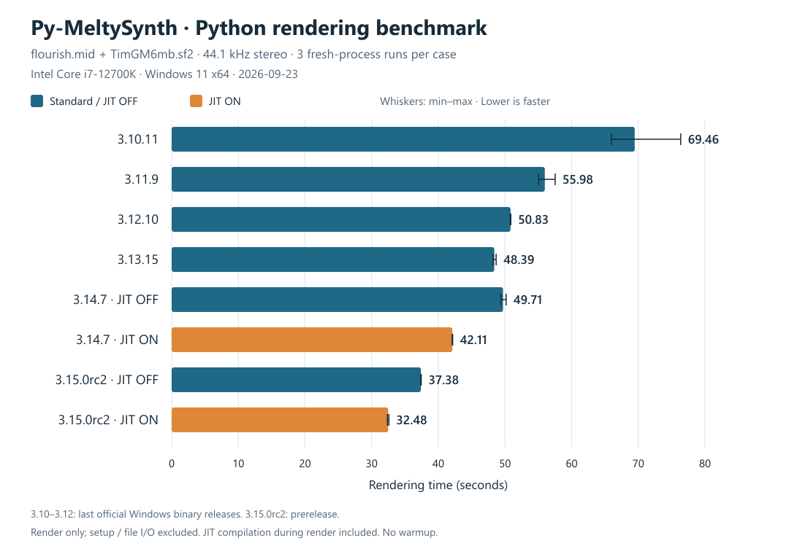
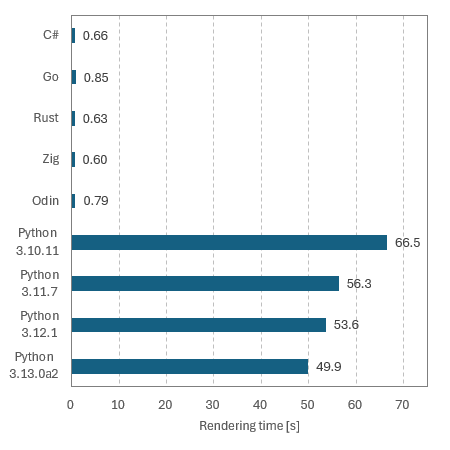

# Py-MeltySynth

Py-MeltySynth is a SoundFont MIDI synthesizer written in pure Python, ported from [MeltySynth for C#](https://github.com/sinshu/meltysynth).
I believe this is the first fully functional SoundFont synthesizer made with Python without external libraries.


## Features

* Support for standard MIDI files.
* No dependencies other than the standard library.
* All the functionality is in a single file. Simply copy [the file](meltysynth.py) into your project and you are ready to go.


## Demo

https://www.youtube.com/watch?v=Pheb0pSzQP8  

[](https://www.youtube.com/watch?v=Pheb0pSzQP8)


## Development status

It works, but it's slow. Without external libraries, sample-by-sample audio processing seems tough for Python...
But Python is said to be becoming more performance oriented, so it should be useful in the future.

### Python rendering benchmark (September 2026)

The MIDI file is [flourish.mid](https://midis.fandom.com/wiki/Flourish) (about 87.5 seconds) and the SoundFont is [TimGM6mb.sf2](https://musescore.org/en/handbook/3/soundfonts-and-sfz-files#gm_soundfonts).
Each configuration was measured three times on Windows 11 x64 with an Intel Core i7-12700K, using official CPython Windows builds at 44,100 Hz stereo.
Each run used a fresh process with no warmup. Only `sequencer.render()` was timed; loading and buffer allocation were excluded. JIT compilation during rendering was included.

| Python | JIT | Run 1 (s) | Run 2 (s) | Run 3 (s) | Mean (s) |
|---|---|---:|---:|---:|---:|
| 3.10.11 | N/A | 66.049 | 76.354 | 65.969 | **69.457** |
| 3.11.9 | N/A | 55.373 | 57.527 | 55.027 | **55.976** |
| 3.12.10 | N/A | 50.877 | 50.801 | 50.827 | **50.835** |
| 3.13.15 | N/A | 48.299 | 48.672 | 48.211 | **48.394** |
| 3.14.7 | OFF | 49.576 | 50.170 | 49.379 | **49.708** |
| 3.14.7 | ON | 42.072 | 42.094 | 42.149 | **42.105** |
| 3.15.0rc2 | OFF | 37.430 | 37.359 | 37.348 | **37.379** |
| 3.15.0rc2 | ON | 32.369 | 32.586 | 32.486 | **32.481** |



JIT reduced mean rendering time by 15.3% on 3.14.7 and 13.1% on 3.15.0rc2. All 24 runs produced identical audio buffer hashes.
Python 3.10's second run was noticeably slower; it is retained in the mean and shown by the range whisker.

Python 3.10.11, 3.11.9 and 3.12.10 are the last official Windows binary releases of their series, not the latest source-only security releases. Python 3.13.15 and 3.14.7 are the latest stable versions as of September 23, 2026; 3.15.0rc2 is a prerelease. N/A means JIT is unavailable in the tested build. The JIT configurations are experimental.
See [measurement details and raw results](benchmarks/20260923_results.md) for the method, build information and source references.

<details>
<summary>Historical cross-language comparison (January 2024)</summary>

The following measurements are historical and were not rerun for the September 2026 Python benchmark.



</details>


## Examples

An example code to synthesize a simple chord:

```python
import meltysynth as ms

# Load the SoundFont.
sound_font = ms.SoundFont.from_file("TimGM6mb.sf2")

# Create the synthesizer.
settings = ms.SynthesizerSettings(44100)
synthesizer = ms.Synthesizer(sound_font, settings)

# Play some notes (middle C, E, G).
synthesizer.note_on(0, 60, 100)
synthesizer.note_on(0, 64, 100)
synthesizer.note_on(0, 67, 100)

# The output buffer (3 seconds).
left = ms.create_buffer(3 * settings.sample_rate)
right = ms.create_buffer(3 * settings.sample_rate)

# Render the waveform.
synthesizer.render(left, right)
```

Another example code to synthesize a MIDI file. It will take a long time 😉

```python
import meltysynth as ms

# Load the SoundFont.
sound_font = ms.SoundFont.from_file("TimGM6mb.sf2")

# Create the synthesizer.
settings = ms.SynthesizerSettings(44100)
synthesizer = ms.Synthesizer(sound_font, settings)

# Load the MIDI file.
midi_file = ms.MidiFile.from_file("flourish.mid")

# Create the MIDI sequencer.
sequencer = ms.MidiFileSequencer(synthesizer)
sequencer.play(midi_file, False)

# The output buffer.
left = ms.create_buffer(int(settings.sample_rate * midi_file.length))
right = ms.create_buffer(int(settings.sample_rate * midi_file.length))

# Render the waveform.
sequencer.render(left, right)
```


## Todo

* __Wave synthesis__
    - [x] SoundFont reader
    - [x] Waveform generator
    - [x] Envelope generator
    - [x] Low-pass filter
    - [x] Vibrato LFO
    - [x] Modulation LFO
* __MIDI message processing__
    - [x] Note on/off
    - [x] Bank selection
    - [x] Modulation
    - [x] Volume control
    - [x] Pan
    - [x] Expression
    - [x] Hold pedal
    - [x] Program change
    - [x] Pitch bend
    - [x] Tuning
* __Effects__
    - [ ] Reverb
    - [ ] Chorus
* __Other things__
    - [x] Standard MIDI file support
    - [ ] Loop extension support
    - [ ] Performace optimization


## License

Py-MeltySynth is available under [the MIT license](LICENSE.txt).
