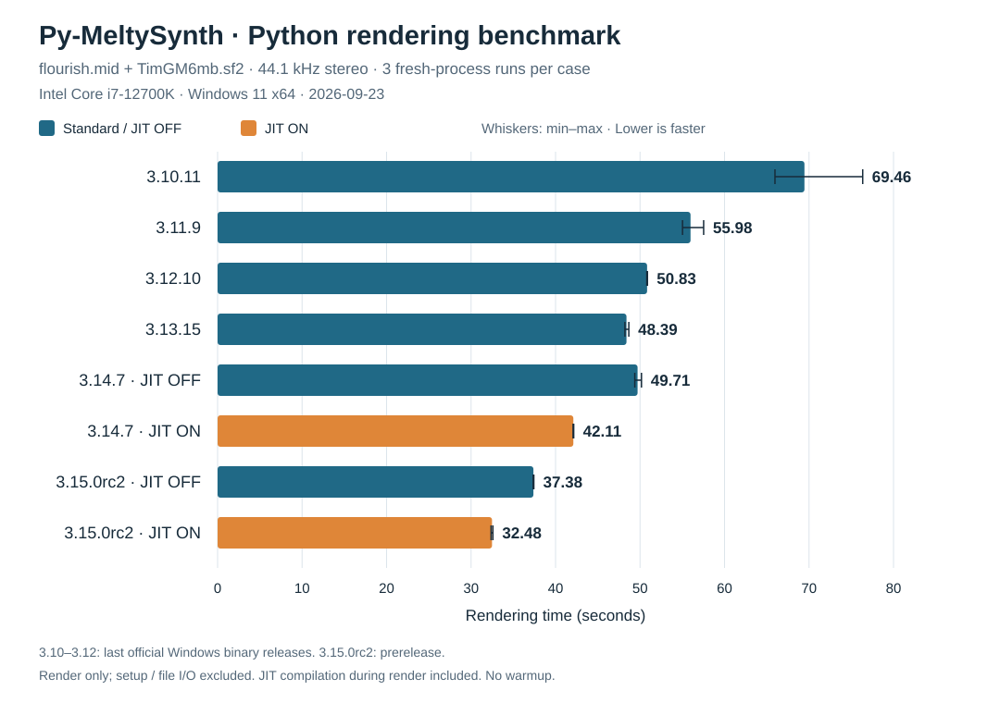

# Python rendering benchmark — 2026-09-23

Windows 11 x64; Intel Core i7-12700K; official CPython Windows embeddable builds.

Input: `flourish.mid` + `TimGM6mb.sf2`; 44,100 Hz stereo; 3,858,749 frames (about 87.5 seconds).
Only `sequencer.render(left, right)` is timed using `time.perf_counter()`. Input loading, buffer allocation, output hashing and WAV saving are excluded.
Each measurement uses a fresh process with no warmup. JIT compilation during render is included. Runs are sequential; case order is reversed in round 2. Values below are seconds; averages use unrounded measurements.

| Python | JIT | Run 1 | Run 2 | Run 3 | Mean |
|---|---|---:|---:|---:|---:|
| 3.10.11 | N/A | 66.049 | 76.354 | 65.969 | **69.457** |
| 3.11.9 | N/A | 55.373 | 57.527 | 55.027 | **55.976** |
| 3.12.10 | N/A | 50.877 | 50.801 | 50.827 | **50.835** |
| 3.13.15 | N/A | 48.299 | 48.672 | 48.211 | **48.394** |
| 3.14.7 | OFF | 49.576 | 50.170 | 49.379 | **49.708** |
| 3.14.7 | ON | 42.072 | 42.094 | 42.149 | **42.105** |
| 3.15.0rc2 | OFF | 37.430 | 37.359 | 37.348 | **37.379** |
| 3.15.0rc2 | ON | 32.369 | 32.586 | 32.486 | **32.481** |

Bars show arithmetic means; thin whiskers show minimum–maximum across three runs. Lower is faster. N/A means JIT is unavailable in the tested build; it does not mean a zero runtime.

Python 3.10's second run was noticeably slower than its other two runs. It is retained in the mean; the cause was not established.

Python 3.10.11, 3.11.9 and 3.12.10 are the last official Windows binary releases in those series, not their latest source-only security releases. Python 3.13.15 and 3.14.7 are the latest stable releases as of the measurement date. Python 3.15.0rc2 is a prerelease. The 3.13 official build used here has no JIT support; no custom Python builds were made.

Sources: [Python releases](https://www.python.org/downloads/), [3.10 binary availability](https://www.python.org/downloads/release/python-31021/), [3.11 binary availability](https://www.python.org/downloads/release/python-31116/), [3.12 binary availability](https://www.python.org/downloads/release/python-31214/), [3.15.0rc2](https://www.python.org/downloads/release/python-3150rc2/).

Distinct rendered-output SHA-256 hashes across all 24 measurements: 1.
Raw measurements, build strings and input/code hashes: [20260923_results.json](20260923_results.json).

The earlier one-off 3.14.7 measurement is excluded. Historical measurements for other languages in the old README graph were not rerun and are not combined with this benchmark.
